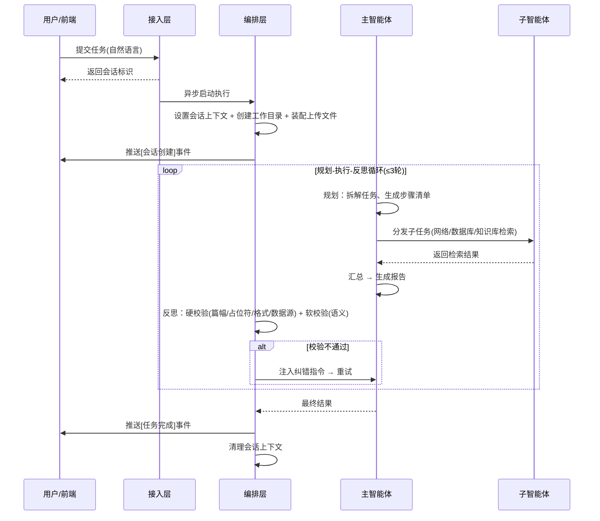

# 探渊 · 技术设计文档（TDD）

## 多智能体数据分析系统

| 产品名称 | 探渊（多智能体数据分析系统） |
| --- | --- |
| 文档类型 | 技术设计文档（Technical Design Document） |
| 文档版本 | v3.0 |
| 文档状态 | 正式发布（自包含开发规格） |
| 编制日期 | 2026-08-13 |
| 输入依据 | 《探渊·需求规格说明书（PRD）》v1.0 |

> 本文档为**自包含开发规格**：包含从零开发所需的全部技术细节（技术栈、目录结构、模块设计、完整提示词、工具规格、接口契约、数据库建表脚本、反思循环设计、配置清单）。开发者仅凭本文档 + 需求文档即可完成编码，无需参考任何既有代码。

---

## 修订历史

| 版本 | 日期 | 修订说明 |
| --- | --- | --- |
| v3.0 | 2026-08-13 | 内部文档检索采用本地向量检索（BGE Embedding + Chroma），去除重型外部服务依赖 |
| v2.0 | 2026-07-13 | 首版自包含开发规格 |

---

## 1. 架构总览

### 1.1 架构风格

**单体分层架构**：单入口、能力聚合，无需微服务。分层职责如下，依赖方向仅允许上层依赖下层。

### 1.2 四层架构

```
┌────────────────────────────────────────────────────────────┐
│  接入层   REST（任务/上传/浏览/下载）+ WebSocket（实时推送）     │
├────────────────────────────────────────────────────────────┤
│  编排层   主智能体（DeepAgents）+ 子智能体组装                  │
│          任务规划 → 执行 → 反思纠错 循环（Loop Engineering）     │
├────────────────────────────────────────────────────────────┤
│  能力层   三路检索工具 + 报告生成工具 + 文件工具                │
│          网络检索 / 数据库查询 / 知识库检索 / PDF生成 / 文件解析  │
├────────────────────────────────────────────────────────────┤
│  基础设施层  LLM / MySQL / 本地向量检索(Chroma) / 全网检索 / 文件系统 │
└────────────────────────────────────────────────────────────┘
        ▲ 横切关注点：会话隔离(ContextVar) · 路径安全 · 日志 · 配置
```

### 1.3 关键设计基调

- **多智能体编排**：采用 **DeepAgents 库**（主智能体 + 子智能体分发）；
- **内部文档检索**：采用**本地向量检索**（BGE Embedding + Chroma，自建 RAG，不依赖第三方 RAG 服务）；
- **质量保障**：编排层内置**任务规划与反思循环**（提示词驱动 + 程序硬校验混合，详见 §5）。

---

## 2. 技术选型（含版本）

| 设计点 | 选型 | 版本/说明 |
| --- | --- | --- |
| 语言 | Python | ≥ 3.12 |
| Web 框架 | FastAPI | ≥ 0.136 |
| ASGI 服务器 | uvicorn | ≥ 0.48 |
| 多智能体框架 | DeepAgents | ≥ 0.6.6（`create_deep_agent`） |
| LLM 接入 | langchain-openai | `init_chat_model`，OpenAI 兼容协议 |
| 大模型 | deepseek | 默认 `deepseek-chat`，可配置切换 |
| 工具定义 | langchain-core | `@tool` 装饰器 |
| 数据库驱动 | mysql-connector-python | ≥ 9.7 |
| 向量数据库 | langchain-chroma | Chroma，本地持久化 |
| Embedding | langchain-huggingface（HuggingFaceEmbeddings）+ sentence-transformers | 本地 BGE 模型 |
| 文档分块 | langchain-text-splitters | RecursiveCharacterTextSplitter |
| 全网检索 | tavily-python | ≥ 0.7 |
| 文档解析 | python-docx / pypdf / openpyxl / pandas | Word / PDF / Excel 读取 |
| PDF 生成 | markdown + pywin32（Word COM） | Markdown→HTML→Word→PDF |
| 会话隔离 | ContextVar | Python 标准库 |
| 日志 | colorlog | 彩色日志 |
| 提示词配置 | pyyaml | 外置 YAML |
| 环境配置 | python-dotenv | 加载 .env |
| 前端框架 | Vue | 3.x（Composition API） |
| 前端构建 | Vite | ≥ 5 |

---

## 3. 目录结构

```
tanyuan/
├── main.py                          # 程序入口：调用 start_server()
├── pyproject.toml                   # 项目与依赖声明
├── .env                             # 环境配置（密钥/服务地址/数据库/Embedding）
├── agent/
│   ├── __init__.py
│   ├── llm.py                       # LLM 初始化
│   ├── load_prompt.py               # 加载 prompts.yaml
│   ├── main_agent.py                # 主智能体组装 + 反思循环执行
│   └── sub_agents/
│       ├── __init__.py
│       ├── web_search_agent.py      # 网络检索子智能体
│       ├── db_query_agent.py        # 数据库查询子智能体
│       └── knowledge_agent.py       # 内部知识库检索子智能体
├── api/
│   ├── __init__.py
│   ├── server.py                    # REST 路由 + WebSocket
│   ├── context.py                   # ContextVar 会话隔离
│   └── monitor.py                   # 事件上报 + 连接管理
├── tools/
│   ├── __init__.py
│   ├── internet_search_tool.py      # 全网检索工具
│   ├── mysql_tools.py               # 数据库三工具
│   ├── knowledge_base_tool.py       # 本地知识库检索工具（RAG）
│   ├── markdown_tools.py            # Markdown 生成
│   ├── pdf_tools.py                 # MD→PDF
│   ├── upload_file_read_tool.py     # 上传文件解析
│   └── reflect_check.py             # 反思循环硬校验器
├── scripts/
│   ├── build_knowledge_base.py      # 离线构建向量索引（一次性）
│   └── eval_rag.py                  # RAG 检索命中率评估
├── utils/
│   ├── __init__.py
│   ├── logger_utils.py              # 日志
│   ├── path_utils.py                # 路径解析与越界防护
│   └── converter_utils.py           # MD→HTML→PDF 核心
├── prompt/
│   └── prompts.yaml                 # 主/子智能体提示词（全文见 §6）
├── sql/
│   └── init.sql                     # 建库建表 + 种子数据（全文见 §9）
├── knowledge_base/                  # 语料：企业内部文档（原始文件）
├── vector_store/                    # 运行时：Chroma 持久化目录
├── eval/
│   └── eval_questions.json          # RAG 评估测试问题集
├── output/                          # 运行时：各会话工作目录
└── upload/                          # 运行时：各会话上传目录
```

```
frontend/                            # 前端（Vue 3 + Vite，独立目录）
├── index.html
├── package.json
├── vite.config.js                   # 开发代理 /api、/ws 到 FastAPI
└── src/
    ├── main.js
    ├── App.vue
    ├── api.js                       # fetch + WebSocket 封装
    └── components/
        ├── TaskInput.vue            # 任务提交输入框
        ├── EventTree.vue            # 事件树容器
        ├── EventNode.vue            # 事件节点（递归渲染主→子→工具层级）
        └── FilePanel.vue            # 文件上传/浏览/下载
```

> 前端为独立工程（`frontend/`），与后端 `tanyuan/` 并列；开发期 Vite 代理到 FastAPI，生产期 build 后由 FastAPI 静态托管。

---

## 4. 模块设计

### 4.1 接入层

| 模块 | 职责 |
| --- | --- |
| server | REST 路由（任务/上传/浏览/下载）+ WebSocket 端点 + 启动引导 |
| context | ContextVar 会话隔离：`set/get/reset` 会话目录与线程标识 |
| monitor | 事件上报（ToolMonitor 单例）+ 连接管理（ConnectionManager，按会话路由） |

### 4.2 编排层

| 模块 | 职责 |
| --- | --- |
| llm | `init_chat_model` 初始化 LLM 实例 |
| load_prompt | 加载 `prompt/prompts.yaml`，导出主/子智能体配置 |
| main_agent | `create_deep_agent` 组装主智能体；`run_deep_agent` 执行反思循环 |
| sub_agents/* | 三个子智能体的配置声明 |

### 4.3 能力层

| 模块 | 工具 | 归属 |
| --- | --- | --- |
| internet_search_tool | `internet_search` | 网络检索子智能体 |
| mysql_tools | `list_sql_tables` / `get_table_data` / `execute_sql_query` | 数据库查询子智能体 |
| knowledge_base_tool | `search_knowledge_base` | 内部知识库检索子智能体 |
| markdown_tools | `generate_markdown` | 主智能体 |
| pdf_tools | `convert_md_to_pdf` | 主智能体 |
| upload_file_read_tool | `read_file_content` | 主智能体 |
| reflect_check | 反思循环硬校验函数（非工具，供编排层调用） | 编排层 |

### 4.4 横切关注点

| 模块 | 职责 |
| --- | --- |
| path_utils | 统一路径解析：虚拟路径清洗、上传目录、嵌套防护、越界校验 |
| logger_utils | 全局彩色日志（时间/文件/行号/级别/消息） |
| converter_utils | Markdown→HTML→Word COM→PDF 核心转换 |

---

## 5. 核心流程与反思循环设计

### 5.1 任务执行全流程



### 5.2 反思循环完整设计（方案 C：提示词驱动 + 程序硬校验混合）

**目标**：保证报告质量，实现"规划 → 执行 → 反思 → 纠错"闭环。

**循环参数**：重试上限 `MAX_ROUNDS = 3`。

**硬校验项（程序级，确定性检查）**：

| 编号 | 校验项 | 判定规则 | 不通过提示 |
| --- | --- | --- | --- |
| H1 | 篇幅 | 报告正文字数 < 1000 | "报告篇幅不足 1000 字" |
| H2 | 占位符 | 含"待补充 / TODO / 等待子任务 / 占位 /（略）"等关键词 | "报告存在未填充占位符" |
| H3 | 格式 | 用户要求 PDF 但未产出 PDF 文件 | "未生成要求的 PDF 文件" |
| H4 | 数据源覆盖 | 任务要求的信息来源未被检索（如要求内部文档但未调用内部知识库检索） | "缺少 {数据源} 的检索结果" |

**软校验项（提示词驱动，语义级）**：主智能体自我审查——是否完整回答了用户问题、数据是否支撑结论、逻辑是否一致。

**伪代码（编排层 `run_deep_agent` 核心逻辑）**：

```python
MAX_ROUNDS = 3

async def run_deep_agent(query, thread_id):
    # 1. 会话上下文：设置 thread_id 与 session 目录
    # 2. 创建工作目录 + 复制上传文件 + 生成工作环境指令
    # 3. 反思循环
    round_num = 0
    while round_num < MAX_ROUNDS:
        round_num += 1
        # 3.1 规划 + 执行（由主智能体完成，提示词驱动）
        result = await main_agent_run(query, round_num)
        # 3.2 硬校验（程序级）
        hard_issues = hard_check(result)   # 返回 [H1..H4] 中未通过的项
        # 3.3 软校验（提示词驱动）
        soft_issue = None
        if not hard_issues:
            soft_issue = await soft_review(result)   # 语义级自我审查
        # 3.4 判定
        if not hard_issues and not soft_issue:
            return result                          # 通过，结束
        # 3.5 生成纠错指令，注入下一轮
        query = build_correction_prompt(query, hard_issues, soft_issue)
    # 4. 达到上限仍未通过：返回最优结果 + 未达标原因
    return result + 未达标说明
```

**关键说明**：

- **硬校验**由 `tools/reflect_check.py` 实现，返回未通过项列表；对报告文本做关键词扫描 + 字数统计 + 文件格式检查 + 数据源调用记录检查；
- **软校验**通过向主智能体追加一轮"反思"提示词实现：让主智能体以审稿人视角审阅报告，返回"通过"或"不通过 + 问题描述"；
- **纠错指令**：将未通过项拼成明确指令（如"报告篇幅不足，请补充 XX 方面内容至 1000 字以上"）注入下一轮 query；
- **数据源调用记录**：编排层需记录本轮实际调用了哪些子智能体，供 H4 校验（如何判定"应调用某数据源"由主智能体在规划阶段声明）。

---

## 6. 完整提示词（prompt/prompts.yaml）

> 以下为完整系统提示词，可直接落为 `prompt/prompts.yaml`。角色定位为通用数据分析平台，医药为示例场景。

### 6.1 主智能体（main_agent）

```yaml
main_agent:
  system_prompt: |
    你是一个企业智能数据分析团队的负责人，负责协调三个专家助手完成复杂的数据分析与报告生成任务。
    你的团队成员如下：
    1. **网络检索助手**：检索互联网公开信息
    2. **数据库查询助手**：查询企业结构化业务数据
    3. **内部知识库助手**：检索企业内部知识库文档

    你的工作流程（规划-执行-反思）：
    - 规划：任务开始前，先拆解任务并生成 todo-list；
    - 执行：按规划调度子智能体获取信息，汇总后生成报告；
    - 反思：对生成结果自我校验，不达标则纠错重试。

    信息获取策略：
    - 公开/背景知识 → 网络检索助手（可由浅入深，可在获取其他结果后再次深入检索）
    - 企业结构化业务数据 → 数据库查询助手
    - 企业私有知识 → 内部知识库助手
    - 边界不明确时，三种方式全部使用
    - 获取信息后，尽可能将完整信息用于报告生成，得到更完善的回答

    文件生成规则：
    - 文件生成仅由你本人完成，子智能体不生成文件，也不被告知文件路径
    - 生成 PDF 时，必须先产出 Markdown，再转换为 PDF
    - 报告内容要求丰富全面，不少于 1000 字
    - 汇报文档生成结果时，不发送文件路径，仅通知"已成功创建"
    - 不得生成用户要求之外的文档类型
    - 严禁使用"等待子任务完成"之类占位符内容

    关键执行顺序：
    1. 必须先调用子智能体获取信息，再生成文件
    2. 绝不允许在获取信息之前调用文件生成工具
    3. 搜索与生成分两步进行，禁止在同一次工具调用中同时做这两件事

    工作目录规则：
    - 所有文件的创建、读取、保存，只能在工作目录内进行
    - 使用相对路径，禁止绝对路径
```

### 6.2 网络检索子智能体（web_search）

```yaml
sub_agents:
  web_search:
    name: "网络检索助手"
    description: |
      负责进行网络知识搜索的智能体助手，当需要从网络中查询非内部公开信息时使用，
      检索后返回检索结果。
    system_prompt: |
      你是一个专业的网络信息查询助手，可以从互联网检索非内部的公开信息。
      你掌握 internet_search 工具，可根据问题从互联网检索公开信息。
      检索规则：同一问题至少从 2 个不同角度检索，最多检索 3 次，超过 3 次禁止继续检索。
```

### 6.3 数据库查询子智能体（db_query）

```yaml
  db_query:
    name: "数据库查询助手"
    description: |
      负责数据库查询的智能体助手，可查看表、读取表数据、查看表结构、执行自定义 SQL 查询。
      数据库包含企业结构化业务数据（示例为药品信息、库存、销售数据）。
    system_prompt: |
      你是一个专业的数据库查询助手，可直接与 MySQL 数据库交互检索信息。
      你掌握的工具：
      1. list_sql_tables：列出所有可用表，是了解数据库结构的第一步
      2. get_table_data：读取指定表前 100 行数据，用于预览表内容和字段
      3. execute_sql_query：执行自定义 SQL，用于复杂筛选、联接或聚合
      通常工作流程：先 list_sql_tables 确认表名 → 需要时 get_table_data 预览字段 → 最后 execute_sql_query 精确查询。
```

### 6.4 内部知识库检索子智能体（knowledge）

```yaml
  knowledge:
    name: "内部知识库助手"
    description: "负责检索企业内部知识库文档的智能体助手，可对企业私有文档做语义检索，返回相关内容片段。"
    system_prompt: |
      你是一个专业的内部知识库检索助手，可通过语义检索从企业私有文档中查找相关信息。
      你掌握的工具：search_knowledge_base（对知识库做语义检索，返回相关文档原文片段）。
      检索规则：
      - 针对同一问题，从多个角度、多个关键词检索，至少检索 3 次；
      - 保留检索到的全部原文片段，不做概括性总结，将原始信息完整传输给后续生成。
```

---

## 7. 工具规格（完整签名与返回）

### 7.1 网络检索工具 `internet_search`

| 项 | 说明 |
| --- | --- |
| 签名 | `internet_search(query: str, max_results: int = 5, topic: Literal["general","news","finance"] = "general", include_raw_content: bool = False)` |
| 行为 | 调用 Tavily 搜索，返回结构化检索结果 |
| 归属 | 网络检索子智能体 |

### 7.2 数据库工具

| 工具 | 签名 | 返回格式 |
| --- | --- | --- |
| list_sql_tables | `list_sql_tables() -> str` | 有表：`可用的表：a,b,c`；无表：`没有可用的表` |
| get_table_data | `get_table_data(table_name: str) -> str` | `字段名1,字段名2,...\n值1,值2,...`（前 100 行）；无数据：`查询表{...},结果没有数据` |
| execute_sql_query | `execute_sql_query(sql: str) -> str` | 同 get_table_data；无数据：`执行语句{...},结果没有数据` |

- 连接配置：从环境变量读取，`charset=utf8mb4`，`autocommit=True`；
- 异常统一返回 `连接数据库失败：{错误}`。

### 7.3 内部知识库检索工具 `search_knowledge_base`

| 工具 | 签名 | 返回格式 |
| --- | --- | --- |
| search_knowledge_base | `search_knowledge_base(query: str, k: int = 4) -> str` | 每个片段：`[来源: 文件名]\n片段文本`，片段间空行分隔；无结果：`知识库中未检索到相关内容` |

- 实现：对本地 Chroma 向量库做相似度检索，返回 top-k 个最相关分块（含元数据中的来源文件名）；
- 依赖：向量库须已由 `scripts/build_knowledge_base.py` 构建；未构建时返回 `知识库索引尚未构建，请先运行 scripts/build_knowledge_base.py`；
- Embedding 模型从环境变量读取（默认 `BAAI/bge-base-zh-v1.5`，支持本地路径）。

### 7.4 文件工具

| 工具 | 签名 | 行为 |
| --- | --- | --- |
| read_file_content | `read_file_content(filename: str, instruction: str = "提取全部内容") -> str` | 按后缀解析：`.md/.txt` 文本、`.docx` 段落、`.pdf` 逐页、`.xlsx/.xls` 返回行列数+前5行+统计描述 |
| generate_markdown | `generate_markdown(content: str, filename: str, path: str = "") -> str` | 写入 Markdown 到会话工作目录，自动补 `.md` 后缀 |
| convert_md_to_pdf | `convert_md_to_pdf(md_filename: str, pdf_filename: Optional[str] = None) -> str` | 校验源文件存在 → 调用转换核心生成 PDF |

---

## 8. 接口设计

### 8.1 REST API

| 接口 | 方法 | 请求 | 响应 |
| --- | --- | --- | --- |
| /api/task | POST | `{"query": str, "thread_id": str\|null}` | `{"status":"started","thread_id":str}` |
| /api/upload | POST | multipart：`files[]` + `thread_id` | `{"status":"uploaded","files":[str]}` |
| /api/files | GET | `?path=<绝对路径>` | `{"files":[{name,type,path,size,mtime}]}`（mtime 倒序） |
| /api/download | GET | `?path=<绝对路径>` | 文件流 / `{"error":...}` |

- **任务异步执行**：`/api/task` 用 `asyncio.create_task` 后台执行，立即返回；
- **越界校验**：`/api/files`、`/api/download` 需校验目标路径位于结果目录内，否则返回拒绝访问。

### 8.2 WebSocket 协议

- 端点：`/ws/{thread_id}`；心跳：收到文本 → 回复 `{"type":"pong","message":"服务端已收到: <原文>"}`。
- 推送消息统一结构：

```json
{
  "type": "monitor_event",
  "event": "<事件类型>",
  "message": "<人类可读描述>",
  "data": {},
  "timestamp": "ISO8601"
}
```

| event | 触发时机 | data |
| --- | --- | --- |
| session_created | 会话工作目录创建后 | `{"path": "<绝对路径>"}` |
| tool_start | 主智能体调用普通工具 | `{"tool_name": "...", "args": {...}}` |
| assistant_call | 主智能体调用子智能体 | `{"assistant_name": "<subagent_type>", "args": "<任务描述>"}` |
| task_result | 返回最终结果 | `{"result": "<文本>"}` |
| error | 执行失败 | （message 为错误说明） |

**子智能体与工具区分**：主智能体发起的调用中，工具名为 `task` 判定为子智能体调度（assistant_call），否则为工具调用（tool_start）。

### 8.3 前端设计（Vue 3 + Vite）

| 项 | 设计 |
| --- | --- |
| 框架 | Vue 3（Composition API）+ Vite，独立 `frontend/` 工程 |
| 组件 | `TaskInput`（任务提交）、`EventTree` + `EventNode`（递归渲染执行层级）、`FilePanel`（上传/浏览/下载） |
| 接口对接 | REST 走 `fetch`（api.js）；WebSocket 用原生 `WebSocket`，`onMounted` 连接、事件 push 进响应式数组 |
| 事件渲染 | `assistant_call` 为父节点、其下 `tool_start` 为子节点，递归渲染「主智能体 → 子智能体 → 工具」层级树 |
| 开发代理 | `vite.config.js` 配置 `/api` → `http://localhost:8000`，`/ws` → `ws://localhost:8000`（`ws: true`） |
| 生产部署 | `npm run build` 产出 `dist/`，由 FastAPI `StaticFiles` 托管，与 API 同源 |

---

## 9. 数据模型设计

### 9.1 数据库建表脚本（sql/init.sql）

```sql
CREATE DATABASE IF NOT EXISTS pharma_db DEFAULT CHARSET utf8mb4;
USE pharma_db;

-- 药品信息表
CREATE TABLE drugs (
    drug_id INT PRIMARY KEY AUTO_INCREMENT,
    generic_name VARCHAR(100) NOT NULL COMMENT '通用名',
    brand_name VARCHAR(100) COMMENT '商品名',
    approval_number VARCHAR(50) COMMENT '批准文号',
    specifications VARCHAR(100) COMMENT '规格',
    dosage_form VARCHAR(50) COMMENT '剂型',
    manufacturer VARCHAR(100) COMMENT '生产厂家',
    therapeutic_area VARCHAR(50) COMMENT '治疗领域',
    description TEXT COMMENT '适应症说明',
    created_at TIMESTAMP DEFAULT CURRENT_TIMESTAMP
);

-- 库存表
CREATE TABLE inventory (
    inventory_id INT PRIMARY KEY AUTO_INCREMENT,
    drug_id INT NOT NULL,
    batch_number VARCHAR(50) NOT NULL COMMENT '生产批号',
    quantity_on_hand INT DEFAULT 0 COMMENT '库存量',
    warehouse_location VARCHAR(50) COMMENT '仓库位置',
    production_date DATE COMMENT '生产日期',
    expiry_date DATE COMMENT '有效期至',
    last_updated TIMESTAMP DEFAULT CURRENT_TIMESTAMP ON UPDATE CURRENT_TIMESTAMP,
    FOREIGN KEY (drug_id) REFERENCES drugs(drug_id) ON DELETE CASCADE
);

-- 销售记录表
CREATE TABLE sales_records (
    sale_id INT PRIMARY KEY AUTO_INCREMENT,
    drug_id INT NOT NULL,
    sale_date DATE NOT NULL COMMENT '销售日期',
    quantity_sold INT NOT NULL COMMENT '销售数量',
    unit_price DECIMAL(10,2) COMMENT '销售单价',
    total_amount DECIMAL(15,2) COMMENT '销售总额',
    customer_name VARCHAR(100) COMMENT '客户名称',
    region VARCHAR(50) COMMENT '销售区域',
    sales_rep VARCHAR(50) COMMENT '销售代表',
    FOREIGN KEY (drug_id) REFERENCES drugs(drug_id) ON DELETE CASCADE
);
```

**种子数据（完整 INSERT，可直接执行）**：

```sql
-- 药品信息（10 条）
INSERT INTO drugs (generic_name, brand_name, approval_number, specifications, dosage_form, manufacturer, therapeutic_area, description) VALUES
('阿莫西林胶囊', '阿莫仙', '国药准字H20051234', '0.25g*24粒', '胶囊剂', '本公司制药', '抗生素', '用于治疗敏感菌引起的上呼吸道感染、泌尿生殖道感染等。'),
('布洛芬缓释胶囊', '芬必得', '国药准字H10900089', '0.3g*20粒', '胶囊剂', '本公司制药', '解热镇痛', '用于缓解轻至中度疼痛如头痛、关节痛、偏头痛、牙痛、肌肉痛、神经痛、痛经。也用于普通感冒或流行性感冒引起的发热。'),
('盐酸二甲双胍片', '格华止', '国药准字H20023345', '0.5g*48片', '片剂', '本公司制药', '糖尿病', '首选用于单纯饮食控制不满意的2型糖尿病患者，尤其是肥胖者。'),
('阿托伐他汀钙片', '立普妥', '国药准字H20055567', '20mg*7片', '片剂', '本公司制药', '心血管', '原发性高胆固醇血症患者，包括家族性高胆固醇血症（杂合子型）或混合性高脂血症。'),
('磷酸奥司他韦胶囊', '达菲', '国药准字H20090123', '75mg*10粒', '胶囊剂', '本公司制药', '抗病毒', '用于成人和1岁及1岁以上儿童的甲型和乙型流感治疗。'),
('注射用头孢曲松钠', '罗氏芬', '国药准字H10920012', '1.0g/支', '注射剂', '本公司制药', '抗生素', '用于敏感致病菌所致的下呼吸道感染、尿路、胆道感染，以及腹腔感染、皮肤软组织感染等。'),
('蒙脱石散', '思密达', '国药准字H20000456', '3g*10袋', '散剂', '本公司制药', '消化系统', '用于成人及儿童急、慢性腹泻。'),
('硝苯地平控释片', '拜新同', '国药准字H20100345', '30mg*30片', '片剂', '本公司制药', '高血压', '1.高血压。2.冠心病。慢性稳定型心绞痛。'),
('阿司匹林肠溶片', '拜阿司匹灵', '国药准字J20130078', '100mg*30片', '片剂', '本公司制药', '心血管', '降低急性心肌梗死疑似患者的发病风险；预防心肌梗死复发。'),
('连花清瘟胶囊', '连花清瘟', '国药准字Z20040063', '0.35g*24粒', '胶囊剂', '本公司制药', '中成药/感冒', '清瘟解毒，宣肺泄热。用于治疗流行性感冒属热毒袭肺证。');

-- 库存（30 条，每种药 3 批次）
INSERT INTO inventory (drug_id, batch_number, quantity_on_hand, warehouse_location, production_date, expiry_date) VALUES
(1,'MY-250101-A',5000,'北京一号库-A区','2025-01-01','2027-01-01'),
(1,'MY-250615-B',8000,'北京二号库-B区','2025-06-15','2027-06-14'),
(1,'MY-251120-C',12000,'天津一号库-A区','2025-11-20','2027-11-19'),
(2,'MY-250101-A',2000,'天津二号库-冷藏区','2025-01-01','2027-01-01'),
(2,'MY-250615-B',15000,'北京一号库-C区','2025-06-15','2027-06-14'),
(2,'MY-251120-C',30000,'天津一号库-A区','2025-11-20','2027-11-19'),
(3,'MY-250101-A',3000,'北京二号库-B区','2025-01-01','2027-01-01'),
(3,'MY-250615-B',4500,'天津二号库-B区','2025-06-15','2027-06-14'),
(3,'MY-251120-C',6000,'北京一号库-A区','2025-11-20','2027-11-19'),
(4,'MY-250101-A',1000,'天津一号库-贵重药区','2025-01-01','2027-01-01'),
(4,'MY-250615-B',2500,'北京二号库-贵重药区','2025-06-15','2027-06-14'),
(4,'MY-251120-C',4000,'天津二号库-贵重药区','2025-11-20','2027-11-19'),
(5,'MY-250101-A',500,'北京一号库-急救药区','2025-01-01','2027-01-01'),
(5,'MY-250615-B',5000,'天津一号库-急救药区','2025-06-15','2027-06-14'),
(5,'MY-251120-C',20000,'北京二号库-急救药区','2025-11-20','2027-11-19'),
(6,'MY-250101-A',2000,'天津二号库-阴凉库','2025-01-01','2027-01-01'),
(6,'MY-250615-B',3500,'北京二号库-阴凉库','2025-06-15','2027-06-14'),
(6,'MY-251120-C',5000,'天津一号库-阴凉库','2025-11-20','2027-11-19'),
(7,'MY-250101-A',4000,'北京一号库-普药区','2025-01-01','2027-01-01'),
(7,'MY-250615-B',8000,'天津二号库-普药区','2025-06-15','2027-06-14'),
(7,'MY-251120-C',12000,'北京二号库-普药区','2025-11-20','2027-11-19'),
(8,'MY-250101-A',1500,'天津一号库-慢病区','2025-01-01','2027-01-01'),
(8,'MY-250615-B',3000,'北京一号库-慢病区','2025-06-15','2027-06-14'),
(8,'MY-251120-C',5000,'天津二号库-慢病区','2025-11-20','2027-11-19'),
(9,'MY-250101-A',2000,'北京二号库-常温区','2025-01-01','2027-01-01'),
(9,'MY-250615-B',4500,'天津一号库-常温区','2025-06-15','2027-06-14'),
(9,'MY-251120-C',7000,'北京一号库-常温区','2025-11-20','2027-11-19'),
(10,'MY-250101-A',10000,'天津二号库-防疫专区','2025-01-01','2027-01-01'),
(10,'MY-250615-B',50000,'北京二号库-防疫专区','2025-06-15','2027-06-14'),
(10,'MY-251120-C',100000,'天津一号库-防疫专区','2025-11-20','2027-11-19');

-- 销售记录（20 条，每种药 2 条）
INSERT INTO sales_records (drug_id, sale_date, quantity_sold, unit_price, total_amount, customer_name, region, sales_rep) VALUES
(1,'2025-02-15',200,25.00,5000.00,'北京朝阳医院','华北区','北京朝阳销售部'),
(1,'2025-08-10',500,24.50,12250.00,'天津大药房','华北区','天津南开销售分部'),
(2,'2025-01-20',1000,15.00,15000.00,'海王星辰连锁','华东区','杭州滨江销售部'),
(2,'2025-12-05',5000,15.00,75000.00,'上海华山医院','华东区','上海静安销售总部'),
(3,'2025-03-10',300,35.00,10500.00,'广州中山医院','华南区','广州越秀销售部'),
(3,'2025-09-22',400,35.00,14000.00,'深圳人民医院','华南区','深圳罗湖销售分部'),
(4,'2025-04-05',100,45.00,4500.00,'成都华西医院','西南区','成都武侯销售部'),
(4,'2025-10-18',150,45.00,6750.00,'重庆大药房','西南区','重庆渝中销售部'),
(5,'2025-01-15',2000,100.00,200000.00,'北京协和医院','华北区','北京东单销售部'),
(5,'2025-11-01',5000,100.00,500000.00,'黑龙江省医院','东北区','哈尔滨香坊销售部'),
(6,'2025-05-20',500,12.00,6000.00,'武汉同济医院','华中区','武汉汉口销售部'),
(6,'2025-07-15',600,12.00,7200.00,'长沙湘雅医院','华中区','长沙开福销售部'),
(7,'2025-06-01',1000,18.00,18000.00,'杭州第一医院','华东区','杭州上城销售部'),
(7,'2025-08-25',2000,18.00,36000.00,'南京鼓楼医院','华东区','南京鼓楼销售部'),
(8,'2025-02-28',200,30.00,6000.00,'西安西京医院','西北区','西安新城销售部'),
(8,'2025-11-11',500,30.00,15000.00,'兰州大学第一医院','西北区','兰州城关销售部'),
(9,'2025-03-15',1000,10.00,10000.00,'济南中心医院','华东区','济南历下销售部'),
(9,'2025-09-09',1200,10.00,12000.00,'青岛市立医院','华东区','青岛市北销售部'),
(10,'2025-01-10',10000,20.00,200000.00,'石家庄以岭药业','华北区','石家庄高新销售部'),
(10,'2025-12-20',50000,20.00,1000000.00,'全国连锁大药房总仓','全国','公司大客户部');
```

### 9.2 内部知识库（本地向量检索）

| 项 | 设计 |
| --- | --- |
| 方案 | 本地向量检索：BGE Embedding（langchain-huggingface）+ Chroma（langchain-chroma） |
| 语料 | `knowledge_base/` 目录下的企业私有文档（PDF / docx / txt / xlsx 等），支持多格式 |
| 构建 | `scripts/build_knowledge_base.py`：加载 → 分块（chunk_size=500, overlap=50）→ 向量化 → 持久化到 `vector_store/` |
| Embedding | 模型名/路径从 .env 读取（默认 `BAAI/bge-base-zh-v1.5`）；首次运行需联网下载，本地已有模型可改路径 |
| 检索 | `search_knowledge_base` 相似度检索返回 top-k 分块，保留原文片段供报告生成 |

> 注：BGE 中文模型检索侧可加前缀「为这个句子生成表示以用于检索相关文章：」提升效果（可通过 HuggingFaceEmbeddings 的 `encode_kwargs` 配置），教学阶段可先不加，影响有限。

### 9.3 文件存储

| 目录 | 用途 |
| --- | --- |
| output/session_{thread_id}/ | 会话工作目录（生成报告 + 上传文件副本） |
| upload/session_{thread_id}/ | 用户上传原始文件暂存 |
| vector_store/ | 知识库向量索引（Chroma 持久化） |

### 9.4 RAG 质量评估

| 项 | 设计 |
| --- | --- |
| 评估集 | `eval/eval_questions.json`，10 条测试问题，每条含 `query` + `expected_source`（期望命中的来源文件名） |
| 检索评估 | `scripts/eval_rag.py`：对每条 query 调 `search_knowledge_base`，检查是否命中 `expected_source`，计算检索命中率 |
| 检索指标 | 命中率 = 命中条数 / 总条数；阈值 0.7，低于则调整分块参数或 embedding 模型 |
| 生成评估（进阶） | 引入 RAGAS：Faithfulness / Answer Relevance / Context Precision / Context Recall 四指标 |

> 评估分两层：检索层（命中率 / Recall / Precision）与生成层（Faithfulness / Relevance）。本阶段先做检索层（不依赖 LLM 当裁判，简单可解释）；生成层评估作为进阶，用 LLM-as-judge。

---

## 10. 关键设计决策（ADR）

### ADR-1 多智能体框架：DeepAgents
- **决策**：采用 DeepAgents（`create_deep_agent`），子智能体以 `{name, description, system_prompt, tools}` 声明。
- **理由**：原生支持主从子智能体调度与流式；与 LangChain 工具生态无缝。

### ADR-2 内部文档检索：本地向量检索（BGE + Chroma）
- **决策**：采用 langchain-chroma + 本地 BGE Embedding 自建本地 RAG。
- **理由**：去除重型外部服务依赖（无需 Docker 单独部署），环境对齐成本低；分块→向量化→检索全链路透明可控，利于教学与排错；BGE 中文语义效果好。负面：需自行维护索引构建与语料更新（由离线脚本完成）。

### ADR-3 质量保障：反思循环（方案 C）
- **决策**：提示词驱动（软校验） + 程序硬校验（H1~H4）混合，重试上限 3 轮。
- **理由**：软校验覆盖语义、硬校验保证确定性指标，兼顾质量与可控。

### ADR-4 会话隔离：ContextVar
- **决策**：用 ContextVar 保存会话目录与标识，任务生命周期内 set/reset。
- **理由**：asyncio 同线程多协程，全局变量串台、threading.local 不隔离协程。
- **局限**：ContextVar 仅在单进程内隔离；多 worker / 多副本部署时需改为显式的「会话 ID → 状态」存储（DB/Redis）。本版为教学简化，生产需注意。

### ADR-5 报告生成：Markdown + Word COM 转 PDF
- **决策**：先产出 Markdown，再经 HTML 转 PDF（Word COM）。
- **理由**：中文/表格渲染稳定、零额外服务；负面是强依赖 Windows/Office。

---

## 11. 非功能落地方案

| NFR | 落地方案 |
| --- | --- |
| 性能 | 任务异步执行；上传流式写入；DB 短连接用完即释放；向量检索本地读取 |
| 安全 | 文件浏览/下载越界校验；DB 走只读账号 + 关键字拦截（禁 DROP/DELETE/UPDATE）；密钥经配置注入 |
| 可靠性 | 智能体异常兜底（记日志 + 推错误事件）；PDF 转换 finally 释放资源；ContextVar 在 finally 重置 |
| 可维护性 | 提示词外置 YAML；分层清晰；统一日志；工具可独立测试；知识库索引由脚本可重建 |
| 可扩展性 | 子智能体/工具插件化注册 |
| 兼容性 | 全链路 UTF-8；Python ≥ 3.12；PDF 依赖 Windows + 本机 Office |

---

## 12. 配置清单（.env）

```ini
# 大模型（OpenAI 兼容协议）
DEEPSEEK_MODEL=deepseek-chat
DEEPSEEK_BASE_URL=https://api.deepseek.com
DEEPSEEK_API_KEY=sk-xxxx

# Tavily 联网搜索
TAVILY_API_KEY=tvly-xxxx

# 内部知识库（本地向量检索）
EMBEDDING_MODEL=BAAI/bge-base-zh-v1.5
EMBEDDING_MODEL_PATH=            # 可选：本地 BGE 模型路径，留空则用模型名联网下载
KNOWLEDGE_BASE_DIR=./knowledge_base
VECTOR_STORE_DIR=./vector_store

# 数据库
MYSQL_HOST=localhost
MYSQL_PORT=3306
MYSQL_USER=root
MYSQL_PASSWORD=xxxx
MYSQL_DATABASE=pharma_db
MYSQL_CHARSET=utf8mb4
```

> 密钥一律经 `.env` 注入，禁止硬编码进代码，`.env` 不应提交到版本库。

---

## 13. 错误处理

| 场景 | 处理 |
| --- | --- |
| 数据库连接/查询失败 | 捕获异常，返回 `连接数据库失败：{错误}` |
| 知识库检索失败 | 捕获异常，返回 `知识库检索失败：{错误}` |
| 向量索引未构建 | 返回 `知识库索引尚未构建，请先运行 scripts/build_knowledge_base.py` |
| 文件不存在 | 返回 `错误：文件不存在 ...` |
| 路径越权 | 文件浏览/下载返回拒绝访问 |
| 智能体执行异常 | 记日志 + 推送 error 事件，不使服务崩溃 |
| 外部服务超时/失败 | 外部调用（LLM/Tavily/MySQL）设置 timeout（建议 30s）与有限重试，失败返回友好错误，避免无限阻塞 |
| PDF 转换失败 | 记日志，返回转换失败，finally 释放资源 |
| 反思多轮未达标 | 返回当前最优结果 + 未达标原因 |

---

## 14. 安全设计

| 项 | 方案 |
| --- | --- |
| 路径穿越 | 统一路径解析 + 越界校验（仅允许会话/结果目录内访问） |
| SQL 注入/误写 | 只读数据库账号（主防线）+ 关键字拦截（辅，禁 DROP/DELETE/UPDATE 等写操作，仅兜底、不可作唯一防线）；查询走参数化 |
| 密钥管理 | 环境配置注入，不入代码库 |
| Prompt 注入 | 用户 query / 上传文件仅视为数据、不作为系统指令；子智能体文件访问受限在工作目录；密钥等敏感信息不进提示词 |
| 多用户隔离 | 会话级 ContextVar 隔离（v1）；账号鉴权与细粒度权限见路线图 v1.3 |

---

## 15. 版本规划与路线图

| 版本 | 能力 | 技术要点 |
| --- | --- | --- |
| v1.0 | 核心（本档） | DeepAgents 编排 + 三路检索（含本地向量检索）+ 反思循环 + PDF 报告 + 会话隔离 |
| v1.1 | 内网完全离线部署 | 本地大模型（替换 DeepSeek 云 API）+ 本地检索（替换 Tavily），去除外部依赖 |
| v1.2 | 会话持久化 | 引入 Checkpointer，保存会话历史与执行状态 |
| v1.3 | 多用户鉴权 | 账号体系 + 数据权限隔离 |

---

## 16. 部署与运行

### 16.1 前置条件

- Python ≥ 3.12，包管理工具（uv 或 pip）；
- Windows + 本机 Microsoft Office（PDF 转换依赖 Word COM）；
- 可用的：大模型服务、全网检索服务、MySQL；
- BGE Embedding 模型（首次运行联网下载，或本地已有模型路径）。

### 16.2 启动步骤

1. 安装依赖；
2. 配置 `.env`（大模型/检索/Embedding/数据库）；
3. 执行 `sql/init.sql` 初始化数据库；
4. 将企业内部文档放入 `knowledge_base/`，运行 `scripts/build_knowledge_base.py` 构建向量索引；
5. 启动服务（默认监听 0.0.0.0:8000）。

### 16.3 验证

- `POST /api/task` 提交任务 → 返回 thread_id → WebSocket 收到完整事件流 → 产出 PDF 报告；
- 上传文件 → 能正确解析并用于分析；
- 多会话并发 → 数据与文件无串扰；
- 知识库检索 → `search_knowledge_base` 能返回相关原文片段。

---

## 17. 开发任务拆解（建议排期）

| 阶段 | 任务 | 前置 |
| --- | --- | --- |
| P0 | 项目骨架、目录结构、.env、日志、路径解析 utils | — |
| P0 | sql/init.sql 建表 + 种子数据、mysql_tools 三工具 | P0 骨架 |
| P0 | knowledge_base_tool + scripts/build_knowledge_base.py、internet_search_tool、llm 初始化 | P0 骨架 |
| P0 | prompt/prompts.yaml（§6 全文） | — |
| P1 | main_agent 组装、run_deep_agent、reflect_check 反思循环 | P0 全部 |
| P1 | markdown_tools、pdf_tools、upload_file_read_tool | P0 骨架 |
| P1 | server（REST+WS）、context、monitor | P1 编排 |
| P2 | 端到端联调、WebSocket 事件验证、异常路径 | 全部 |
| P2 | 安全加固（只读账号/越界/关键字拦截）、反思循环调优 | 联调 |
| P2 | RAG 评估：eval_questions.json + eval_rag.py 命中率 +（进阶）RAGAS | 联调 |
| P2 | 前端（Vue 3 + Vite）：TaskInput / EventTree / EventNode / FilePanel + Vite 代理 | 联调 |
